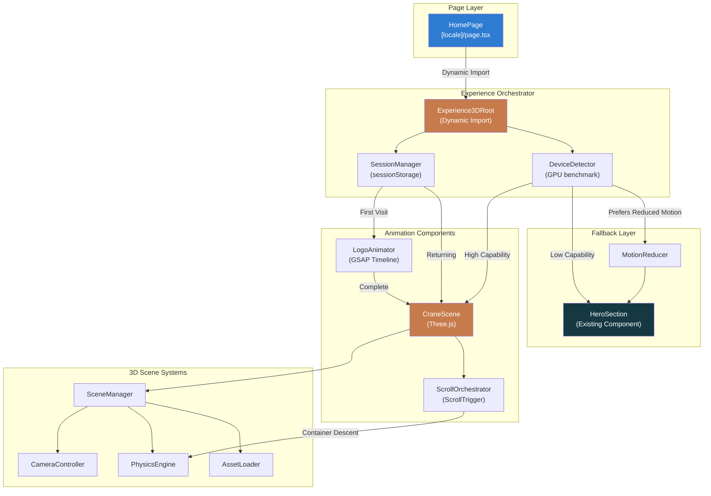
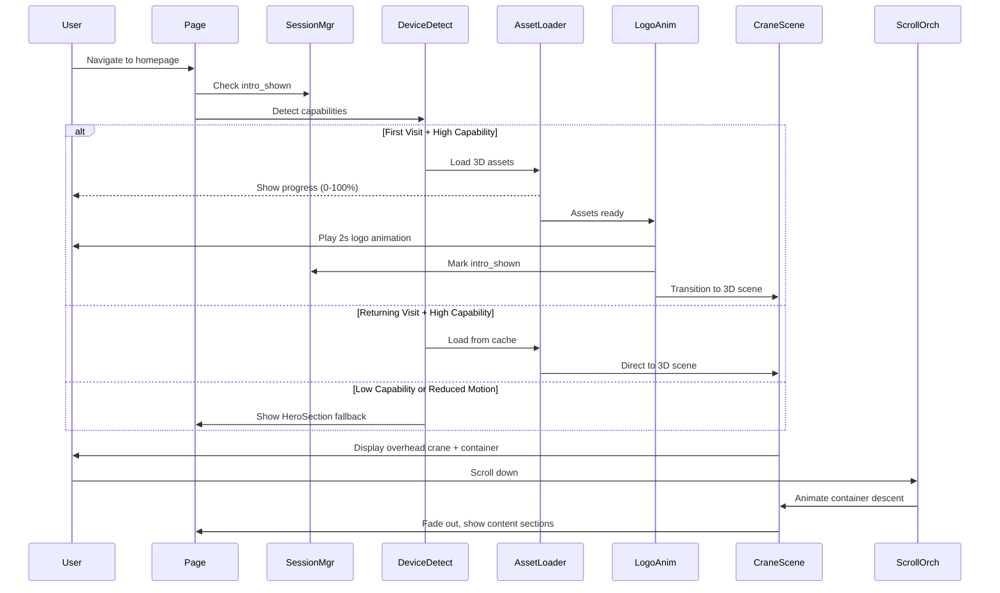

# Design Document: Premium 3D Animated Logistics Experience

## Overview

This design specifies a high-impact, immersive 3D animated logistics experience for the RKLT website. The system integrates a sophisticated Three.js-powered 3D crane scene with GSAP-driven scroll animations to showcase RKLT's multimodal logistics capabilities through a premium visual narrative.

### Design Goals

1. **Visual Excellence**: Create a memorable first impression through sophisticated 3D animation that communicates premium service quality
2. **Performance First**: Maintain 60fps on capable devices while gracefully degrading on lower-end hardware
3. **Seamless Integration**: Embed within existing Next.js architecture without disrupting current functionality
4. **Progressive Enhancement**: Provide baseline experience for all users with enhanced 3D for capable devices
5. **Accessibility**: Respect user preferences for reduced motion and provide appropriate fallbacks

### System Boundary

**In Scope:**
- Logo paint animation with session-aware intro skip
- 3D overhead crane scene with suspended container physics
- Scroll-driven container descent animation
- Device-adaptive rendering pipeline
- Progressive asset loading with compression
- Multi-language UI elements (EN/AR)
- Performance monitoring and adaptive degradation

**Out of Scope:**
- Backend API integration for real-time cargo tracking
- User-interactive 3D controls (rotation, zoom)
- Multiple concurrent 3D scenes
- Video recording or screenshot functionality
- VR/AR experiences

### Technology Stack

| Component | Technology | Version | Purpose |
|-----------|-----------|---------|---------|
| 3D Rendering | Three.js | ≥0.160.0 | WebGL scene management, camera, lighting, geometry |
| Animation | GSAP | ≥3.12.0 | Timeline orchestration, ScrollTrigger integration |
| Framework | Next.js | 14.2+ | SSR, routing, dynamic imports |
| Language | TypeScript | 5.6+ | Type safety across component interfaces |
| Styling | Tailwind CSS | 3.4+ | Consistent design token usage |
| Compression | Draco | via Three.js | 3D model compression (40%+ reduction) |

## Architecture

### High-Level Component Architecture



### Data Flow Architecture



### Component Hierarchy

```
app/[locale]/page.tsx
├── <Experience3DRoot> (dynamic import, client-only)
│   ├── <SessionManager> (sessionStorage wrapper)
│   ├── <DeviceDetector> (GPU benchmark, capability check)
│   ├── <LoadingScreen> (asset progress indicator)
│   ├── <LogoAnimator> (conditional, first-visit only)
│   │   └── <SkipControl> (ESC key + click handler)
│   └── <CraneScene3D>
│       ├── <Three.Canvas> (WebGL context)
│       │   ├── <PerspectiveCamera>
│       │   ├── <AmbientLight>
│       │   ├── <DirectionalLight>
│       │   ├── <CraneStructure> (3D model)
│       │   ├── <Container> (physics-driven)
│       │   ├── <Cables> (IK-based geometry)
│       │   ├── <Ocean> (animated plane)
│       │   └── <Environment> (fog, skybox)
│       ├── <ScrollOrchestrator> (GSAP ScrollTrigger)
│       └── <PerformanceMonitor> (FPS tracking)
└── <CredibilityStrip> (existing component)
```

## Components and Interfaces

### 1. Experience3DRoot Component

**Purpose**: Top-level orchestrator that manages session state, device detection, and conditional rendering of 3D experience vs fallback.

**Interface:**
```typescript
interface Experience3DRootProps {
  locale: Locale;
  onComplete?: () => void;
}

interface Experience3DState {
  hasSeenIntro: boolean;
  deviceCapability: DeviceCapability;
  loadingProgress: number;
  isReady: boolean;
  error: Error | null;
}

type DeviceCapability = 'high' | 'medium' | 'low' | 'reduced-motion';
```

**Responsibilities:**
- Check `sessionStorage.getItem('rklt_intro_shown')`
- Invoke `DeviceDetector` to determine capability level
- Dynamically import Three.js and GSAP only when needed
- Render `LogoAnimator` on first visit, `CraneScene3D` on return
- Render `HeroSection` fallback for low capability or errors
- Emit analytics events (logo_animation_start, fallback_activated)

**Implementation Pattern:**
```typescript
'use client';

export const Experience3DRoot: React.FC<Experience3DRootProps> = ({ locale }) => {
  const [state, setState] = useState<Experience3DState>({
    hasSeenIntro: false,
    deviceCapability: 'high',
    loadingProgress: 0,
    isReady: false,
    error: null
  });

  useEffect(() => {
    // Check session
    const introShown = sessionStorage.getItem('rklt_intro_shown') === 'true';
    
    // Detect device
    const capability = detectDeviceCapability();
    
    setState(prev => ({ ...prev, hasSeenIntro: introShown, deviceCapability: capability }));
    
    if (capability === 'low' || capability === 'reduced-motion') {
      // Skip 3D, use fallback
      return;
    }
    
    // Dynamic import Three.js + GSAP
    Promise.all([
      import('three'),
      import('gsap'),
      import('gsap/ScrollTrigger')
    ]).then(() => {
      setState(prev => ({ ...prev, isReady: true }));
    }).catch(err => {
      setState(prev => ({ ...prev, error: err }));
    });
  }, []);

  if (state.error || state.deviceCapability === 'low') {
    return <HeroSection locale={locale} />;
  }
  
  if (state.deviceCapability === 'reduced-motion') {
    return <MotionReducedExperience locale={locale} />;
  }

  if (!state.isReady) {
    return <LoadingScreen progress={state.loadingProgress} locale={locale} />;
  }

  if (!state.hasSeenIntro) {
    return (
      <LogoAnimator 
        locale={locale}
        onComplete={() => {
          sessionStorage.setItem('rklt_intro_shown', 'true');
          setState(prev => ({ ...prev, hasSeenIntro: true }));
        }}
      />
    );
  }

  return <CraneScene3D locale={locale} deviceCapability={state.deviceCapability} />;
};
```

### 2. SessionManager Utility

**Purpose**: Centralized session tracking for intro animation state.

**Interface:**
```typescript
interface SessionManager {
  hasSeenIntro(): boolean;
  markIntroSeen(): void;
  clearIntroFlag(): void;
}

const SESSION_KEY = 'rklt_intro_shown';

export const sessionManager: SessionManager = {
  hasSeenIntro: () => {
    if (typeof window === 'undefined') return false;
    try {
      return sessionStorage.getItem(SESSION_KEY) === 'true';
    } catch {
      return false; // sessionStorage unavailable
    }
  },
  
  markIntroSeen: () => {
    if (typeof window === 'undefined') return;
    try {
      sessionStorage.setItem(SESSION_KEY, 'true');
    } catch {
      // Silent fail
    }
  },
  
  clearIntroFlag: () => {
    if (typeof window === 'undefined') return;
    try {
      sessionStorage.removeItem(SESSION_KEY);
    } catch {
      // Silent fail
    }
  }
};
```

**Storage Strategy:**
- Use `sessionStorage` (not `localStorage`) so intro replays in new browser sessions
- Persist only for duration of browser tab lifetime
- Gracefully handle unavailable storage (return false, skip intro)

### 3. DeviceDetector System

**Purpose**: Perform GPU capability assessment and determine appropriate rendering complexity.

**Interface:**
```typescript
interface DeviceCapability {
  level: 'high' | 'medium' | 'low' | 'reduced-motion';
  reason: string;
  gpuScore?: number;
  screenWidth: number;
  screenHeight: number;
  pixelRatio: number;
  prefersReducedMotion: boolean;
}

function detectDeviceCapability(): DeviceCapability;
```

**Detection Algorithm:**

```typescript
export function detectDeviceCapability(): DeviceCapability {
  // Check reduced motion preference first
  if (window.matchMedia('(prefers-reduced-motion: reduce)').matches) {
    return {
      level: 'reduced-motion',
      reason: 'User prefers reduced motion',
      screenWidth: window.innerWidth,
      screenHeight: window.innerHeight,
      pixelRatio: window.devicePixelRatio,
      prefersReducedMotion: true
    };
  }

  const width = window.innerWidth;
  const height = window.innerHeight;
  const pixelRatio = window.devicePixelRatio;

  // Mobile detection
  if (width < 768) {
    return {
      level: 'low',
      reason: 'Mobile screen width < 768px',
      screenWidth: width,
      screenHeight: height,
      pixelRatio,
      prefersReducedMotion: false
    };
  }

  // GPU benchmark
  const gpuScore = benchmarkGPU();
  
  if (gpuScore < 30) {
    return {
      level: 'low',
      reason: `GPU score ${gpuScore} below threshold 30`,
      gpuScore,
      screenWidth: width,
      screenHeight: height,
      pixelRatio,
      prefersReducedMotion: false
    };
  }

  if (gpuScore < 60 || width < 1024) {
    return {
      level: 'medium',
      reason: `GPU score ${gpuScore} or tablet width`,
      gpuScore,
      screenWidth: width,
      screenHeight: height,
      pixelRatio,
      prefersReducedMotion: false
    };
  }

  return {
    level: 'high',
    reason: `GPU score ${gpuScore}, desktop width ${width}`,
    gpuScore,
    screenWidth: width,
    screenHeight: height,
    pixelRatio,
    prefersReducedMotion: false
  };
}

function benchmarkGPU(): number {
  const canvas = document.createElement('canvas');
  const gl = canvas.getContext('webgl2') || canvas.getContext('webgl');
  
  if (!gl) return 0;

  // Render 1000 triangles and measure time
  const startTime = performance.now();
  
  // Create simple geometry buffer
  const vertices = new Float32Array(3000 * 3); // 1000 triangles * 3 vertices * 3 coords
  for (let i = 0; i < vertices.length; i++) {
    vertices[i] = Math.random() * 2 - 1;
  }

  const buffer = gl.createBuffer();
  gl.bindBuffer(gl.ARRAY_BUFFER, buffer);
  gl.bufferData(gl.ARRAY_BUFFER, vertices, gl.STATIC_DRAW);

  // Simple shader
  const vertexShader = gl.createShader(gl.VERTEX_SHADER)!;
  gl.shaderSource(vertexShader, `
    attribute vec3 position;
    void main() {
      gl_Position = vec4(position, 1.0);
    }
  `);
  gl.compileShader(vertexShader);

  const fragmentShader = gl.createShader(gl.FRAGMENT_SHADER)!;
  gl.shaderSource(fragmentShader, `
    precision mediump float;
    void main() {
      gl_FragColor = vec4(1.0, 0.5, 0.3, 1.0);
    }
  `);
  gl.compileShader(fragmentShader);

  const program = gl.createProgram()!;
  gl.attachShader(program, vertexShader);
  gl.attachShader(program, fragmentShader);
  gl.linkProgram(program);
  gl.useProgram(program);

  // Draw
  const positionLoc = gl.getAttribLocation(program, 'position');
  gl.enableVertexAttribArray(positionLoc);
  gl.vertexAttribPointer(positionLoc, 3, gl.FLOAT, false, 0, 0);
  
  gl.clear(gl.COLOR_BUFFER_BIT);
  gl.drawArrays(gl.TRIANGLES, 0, 3000);
  gl.finish();

  const endTime = performance.now();
  const renderTime = endTime - startTime;

  // Score: fps equivalent for this workload
  // Target: 16.67ms for 60fps = score 60
  const score = Math.round(1000 / renderTime);

  // Cleanup
  gl.deleteShader(vertexShader);
  gl.deleteShader(fragmentShader);
  gl.deleteProgram(program);
  gl.deleteBuffer(buffer);

  return Math.min(score, 120); // Cap at 120
}
```

**Capability Thresholds:**
- **High**: Desktop width ≥1024px, GPU score ≥60, 60fps target
- **Medium**: Tablet width 768-1023px or GPU score 30-59, 30fps target
- **Low**: Mobile width <768px or GPU score <30, 2D fallback
- **Reduced Motion**: `prefers-reduced-motion: reduce`, static fallback

### 4. LogoAnimator Component

**Purpose**: Render 2-second RKLT logo paint animation on first visit.

**Interface:**
```typescript
interface LogoAnimatorProps {
  locale: Locale;
  onComplete: () => void;
  onSkip?: () => void;
}
```

**Animation Specifications:**

| Property | Value | Easing |
|----------|-------|--------|
| Duration | 2000ms | easeInOutQuad |
| Letter Sequence | R → K → L → T | 500ms each |
| Stroke Draw | dashoffset 100% → 0% | per letter |
| Fill Delay | 200ms after stroke | per letter |
| Background | ink-950 (#0B2027) | solid |
| Text Color | terracotta-500 (#C77B4C) | after fill |

**GSAP Timeline:**
```typescript
const timeline = gsap.timeline({
  onComplete: () => {
    setTimeout(onComplete, 300); // 300ms pause before transition
  }
});

// R letter
timeline.to('.letter-r path', {
  strokeDashoffset: 0,
  duration: 0.5,
  ease: 'power2.inOut'
}, 0);
timeline.to('.letter-r path', {
  fill: '#C77B4C',
  duration: 0.2,
  ease: 'power2.out'
}, 0.7);

// K letter (offset by 0.5s)
timeline.to('.letter-k path', {
  strokeDashoffset: 0,
  duration: 0.5,
  ease: 'power2.inOut'
}, 0.5);
timeline.to('.letter-k path', {
  fill: '#C77B4C',
  duration: 0.2,
  ease: 'power2.out'
}, 1.2);

// L letter
timeline.to('.letter-l path', {
  strokeDashoffset: 0,
  duration: 0.5,
  ease: 'power2.inOut'
}, 1.0);
timeline.to('.letter-l path', {
  fill: '#C77B4C',
  duration: 0.2,
  ease: 'power2.out'
}, 1.7);

// T letter
timeline.to('.letter-t path', {
  strokeDashoffset: 0,
  duration: 0.5,
  ease: 'power2.inOut'
}, 1.5);
timeline.to('.letter-t path', {
  fill: '#C77B4C',
  duration: 0.2,
  ease: 'power2.out'
}, 2.2);
```

**Skip Control:**
- Position: bottom-right (bottom-left for Arabic)
- Keyboard: ESC key triggers skip
- Visual: 90% opacity, terracotta-300 text
- Label: "Skip Intro" (EN) / "تخطي المقدمة" (AR)

**Implementation Notes:**
- Use SVG `<path>` elements with `stroke-dasharray` and `stroke-dashoffset`
- Calculate path length with `getTotalLength()` for accurate dash animation
- Render on full-screen overlay with `z-index: 50`
- Dispose of DOM elements and GSAP timeline on complete/skip

### 5. CraneScene3D Component

**Purpose**: Main 3D scene rendering overhead crane with suspended container and physics simulation.

**Interface:**
```typescript
interface CraneScene3DProps {
  locale: Locale;
  deviceCapability: DeviceCapability;
}

interface CraneScene3DState {
  isLoading: boolean;
  loadProgress: number;
  containerType: ContainerType;
  swayAngle: number;
  scrollProgress: number;
}

type ContainerType = '20ft' | '40ft' | 'reefer' | 'refrigerated' | 'roro' | 'project';
```

**Scene Configuration:**

```typescript
const SCENE_CONFIG = {
  camera: {
    fov: {
      mobile: 60,    // < 768px
      tablet: 75,    // 768-1024px
      desktop: 85    // > 1024px
    },
    position: { x: 0, y: 25, z: 15 },
    near: 0.1,
    far: 1000
  },
  lighting: {
    ambient: {
      color: 0xffffff,
      intensity: 0.4
    },
    directional: {
      color: 0xffffff,
      intensity: 0.8,
      position: { x: 10, y: 20, z: 10 },
      castShadow: true
    }
  },
  fog: {
    color: 0x0B2027, // ink-950
    near: 30,
    far: 100
  },
  renderer: {
    antialias: true,
    alpha: true,
    powerPreference: 'high-performance'
  }
};
```

**Container Dimensions (meters):**

| Type | Length | Width | Height | Special Features |
|------|--------|-------|--------|------------------|
| 20ft | 6.1 | 2.4 | 2.6 | Standard ISO |
| 40ft | 12.2 | 2.4 | 2.6 | Standard ISO |
| Reefer | 6.1 | 2.4 | 2.9 | Cooling unit visible |
| Refrigerated | 12.2 | 2.4 | 2.9 | Cooling unit visible |
| RoRo | 12.2 | 2.4 | 2.6 | Open sides, wheels |
| Project | 15.0 | 3.5 | 3.5 | Oversized, special rigging |

**Rendering Loop:**
```typescript
function animate() {
  requestAnimationFrame(animate);
  
  // Update physics
  const deltaTime = clock.getDelta();
  physicsEngine.update(deltaTime);
  
  // Update container position from physics
  container.rotation.x = physicsEngine.swayAngleX;
  container.rotation.z = physicsEngine.swayAngleZ;
  
  // Update cables
  updateCableGeometry();
  
  // Update ocean animation
  ocean.material.uniforms.time.value += deltaTime;
  
  // Performance monitoring
  performanceMonitor.recordFrame();
  
  renderer.render(scene, camera);
}
```

**Resource Disposal:**
```typescript
function dispose() {
  // Stop animation loop
  cancelAnimationFrame(animationId);
  
  // Dispose geometries
  scene.traverse((object) => {
    if (object instanceof THREE.Mesh) {
      object.geometry.dispose();
      if (object.material instanceof THREE.Material) {
        object.material.dispose();
      }
      if (Array.isArray(object.material)) {
        object.material.forEach(mat => mat.dispose());
      }
    }
  });
  
  // Dispose renderer
  renderer.dispose();
  renderer.forceContextLoss();
  
  // Clear scene
  scene.clear();
}
```

### 6. PhysicsEngine System

**Purpose**: Simulate realistic container sway with damped harmonic motion.

**Physics Model:**

The container sway is modeled as a damped pendulum system:

```
θ''(t) + 2ζω₀θ'(t) + ω₀²θ(t) = 0

where:
- θ(t) = angular displacement (sway angle)
- ζ = damping ratio (0.05 - 0.15)
- ω₀ = natural frequency (rad/s)
```

**Interface:**
```typescript
interface PhysicsEngine {
  swayAngleX: number;
  swayAngleZ: number;
  update(deltaTime: number): void;
  setAmplitude(amplitude: number): void;
  getDampingRatio(): number;
}

interface PhysicsConfig {
  amplitude: number;        // degrees (0.5 - 2.0)
  dampingRatio: number;     // unitless (0.05 - 0.15)
  frequency: number;        // Hz (0.3 - 0.8)
  initialPhaseX: number;    // radians
  initialPhaseZ: number;    // radians
}
```

**Implementation:**
```typescript
class ContainerPhysicsEngine implements PhysicsEngine {
  private config: PhysicsConfig;
  private time: number = 0;
  public swayAngleX: number = 0;
  public swayAngleZ: number = 0;

  constructor(config: Partial<PhysicsConfig> = {}) {
    this.config = {
      amplitude: 1.5,
      dampingRatio: 0.1,
      frequency: 0.5,
      initialPhaseX: 0,
      initialPhaseZ: Math.PI / 2, // 90° out of phase for circular motion
      ...config
    };
  }

  update(deltaTime: number): void {
    this.time += deltaTime;

    const omega = 2 * Math.PI * this.config.frequency;
    const damping = Math.exp(-this.config.dampingRatio * omega * this.time);
    
    // Damped sinusoidal motion
    this.swayAngleX = 
      this.config.amplitude * 
      damping * 
      Math.sin(omega * this.time + this.config.initialPhaseX);
    
    this.swayAngleZ = 
      this.config.amplitude * 
      damping * 
      Math.sin(omega * this.time + this.config.initialPhaseZ);
    
    // Convert degrees to radians for Three.js
    this.swayAngleX = (this.swayAngleX * Math.PI) / 180;
    this.swayAngleZ = (this.swayAngleZ * Math.PI) / 180;
  }

  setAmplitude(amplitude: number): void {
    this.config.amplitude = amplitude;
  }

  getDampingRatio(): number {
    return this.config.dampingRatio;
  }
}
```

**Amplitude Modulation During Scroll:**

As user scrolls and container descends, amplitude reduces linearly:
```typescript
const scrollProgress = scrollY / window.innerHeight; // 0 to 1
const currentAmplitude = 2.0 * (1 - scrollProgress); // 2.0 → 0
physicsEngine.setAmplitude(currentAmplitude);
```

### 7. Cable System with Inverse Kinematics

**Purpose**: Render four cables connecting crane spreader to container corners with realistic angles.

**Cable Specifications:**
- Diameter: 0.1m
- Material: Metallic, roughness 0.6
- Color: #4A5568 (gray metallic)
- Segments: 8 (for smooth curves under load)

**Inverse Kinematics Calculation:**

```typescript
interface CablePoint {
  top: THREE.Vector3;    // Crane spreader attachment
  bottom: THREE.Vector3; // Container corner
}

function updateCableGeometry(
  cables: THREE.Mesh[],
  container: THREE.Mesh,
  spreaderPosition: THREE.Vector3
): void {
  const corners = [
    new THREE.Vector3(-containerWidth/2, 0, -containerDepth/2),  // Front-left
    new THREE.Vector3(containerWidth/2, 0, -containerDepth/2),   // Front-right
    new THREE.Vector3(-containerWidth/2, 0, containerDepth/2),   // Back-left
    new THREE.Vector3(containerWidth/2, 0, containerDepth/2)     // Back-right
  ];

  corners.forEach((corner, index) => {
    // Transform corner to world space
    const worldCorner = corner.clone();
    worldCorner.applyMatrix4(container.matrixWorld);

    // Calculate cable direction
    const direction = worldCorner.clone().sub(spreaderPosition);
    const length = direction.length();
    
    // Position cable
    const cable = cables[index];
    cable.position.copy(spreaderPosition);
    cable.lookAt(worldCorner);
    
    // Scale cable to match distance
    cable.scale.set(1, length, 1);
    
    // Ensure cables stay taut (no slack)
    if (length < MIN_CABLE_LENGTH) {
      cable.visible = false;
    } else {
      cable.visible = true;
    }
  });
}
```

**Cable Geometry:**
```typescript
function createCable(): THREE.Mesh {
  const geometry = new THREE.CylinderGeometry(
    0.05,  // radiusTop
    0.05,  // radiusBottom
    1,     // height (will be scaled)
    8,     // radialSegments
    8      // heightSegments
  );
  
  // Rotate to point upward initially
  geometry.rotateX(Math.PI / 2);
  
  const material = new THREE.MeshStandardMaterial({
    color: 0x4A5568,
    metalness: 0.8,
    roughness: 0.6
  });
  
  return new THREE.Mesh(geometry, material);
}
```

### 8. ScrollOrchestrator with GSAP ScrollTrigger

**Purpose**: Coordinate scroll-driven animations for container descent and scene fade-out.

**ScrollTrigger Configuration:**

```typescript
import gsap from 'gsap';
import { ScrollTrigger } from 'gsap/ScrollTrigger';

gsap.registerPlugin(ScrollTrigger);

function initScrollOrchestrator(
  container: THREE.Mesh,
  scene: THREE.Scene,
  physicsEngine: PhysicsEngine
) {
  const timeline = gsap.timeline({
    scrollTrigger: {
      trigger: '.crane-scene-container',
      start: 'top top',
      end: '+=100vh', // One viewport height
      scrub: 1,       // Smooth scrubbing
      pin: true,      // Pin scene while scrolling
      anticipatePin: 1
    }
  });

  // Container descent
  timeline.to(container.position, {
    y: -15,  // Descend 15 meters
    ease: 'power2.out',
    onUpdate: function() {
      // Reduce sway amplitude as container descends
      const progress = this.progress();
      physicsEngine.setAmplitude(2.0 * (1 - progress));
    }
  }, 0);

  // Scene fade out
  timeline.to('.crane-scene-container', {
    opacity: 0,
    duration: 0.4,
    ease: 'power2.inOut'
  }, 0.7);

  // Cleanup on scroll past
  ScrollTrigger.create({
    trigger: '.crane-scene-container',
    start: 'top top',
    end: '+=100vh',
    onLeave: () => {
      // Dispose 3D resources
      disposeCraneScene();
    }
  });
}
```

**Scroll Performance Optimization:**

```typescript
// Use transform3d for GPU acceleration
const container = document.querySelector('.crane-scene-container');
container.style.willChange = 'transform, opacity';

// Throttle scroll events
let ticking = false;
function onScroll() {
  if (!ticking) {
    requestAnimationFrame(() => {
      updateScrollPosition();
      ticking = false;
    });
    ticking = true;
  }
}

window.addEventListener('scroll', onScroll, { passive: true });
```

**Cumulative Layout Shift (CLS) Prevention:**

```typescript
// Reserve space for 3D scene to prevent layout shift
const sceneContainer = document.querySelector('.crane-scene-container');
sceneContainer.style.minHeight = '100vh';
sceneContainer.style.position = 'relative';

// Position content sections below
const contentSections = document.querySelector('.content-sections');
contentSections.style.position = 'relative';
contentSections.style.zIndex = '10';
```

### 9. AssetLoader with Progressive Loading

**Purpose**: Load and optimize 3D models, textures with compression and progress tracking.

**Interface:**
```typescript
interface AssetLoader {
  load(assetManifest: AssetManifest, onProgress: (progress: number) => void): Promise<LoadedAssets>;
  dispose(assets: LoadedAssets): void;
}

interface AssetManifest {
  models: ModelAsset[];
  textures: TextureAsset[];
  priority: 'critical' | 'high' | 'low';
}

interface ModelAsset {
  id: string;
  url: string;
  compression: 'draco' | 'none';
  size: number;
}

interface TextureAsset {
  id: string;
  url: string;
  format: 'jpg' | 'png' | 'webp';
  size: number;
}

interface LoadedAssets {
  models: Map<string, THREE.Group>;
  textures: Map<string, THREE.Texture>;
  totalSize: number;
}
```

**Asset Manifest:**

```typescript
const ASSET_MANIFEST: AssetManifest = {
  models: [
    {
      id: 'crane-structure',
      url: '/models/crane-overhead.glb',
      compression: 'draco',
      size: 180000 // ~180KB compressed
    },
    {
      id: 'container-20ft',
      url: '/models/container-20ft.glb',
      compression: 'draco',
      size: 85000
    },
    {
      id: 'container-40ft',
      url: '/models/container-40ft.glb',
      compression: 'draco',
      size: 95000
    },
    {
      id: 'container-reefer',
      url: '/models/container-reefer.glb',
      compression: 'draco',
      size: 110000
    }
  ],
  textures: [
    {
      id: 'container-diffuse',
      url: '/textures/container-atlas.webp',
      format: 'webp',
      size: 120000
    },
    {
      id: 'container-normal',
      url: '/textures/container-normal.webp',
      format: 'webp',
      size: 95000
    },
    {
      id: 'ocean-normal',
      url: '/textures/ocean-normal.jpg',
      format: 'jpg',
      size: 65000
    }
  ],
  priority: 'critical'
};
```

**Loading Implementation:**

```typescript
import { GLTFLoader } from 'three/examples/jsm/loaders/GLTFLoader';
import { DRACOLoader } from 'three/examples/jsm/loaders/DRACOLoader';
import { TextureLoader } from 'three';

class Asset3DLoader implements AssetLoader {
  private gltfLoader: GLTFLoader;
  private textureLoader: TextureLoader;

  constructor() {
    this.gltfLoader = new GLTFLoader();
    
    // Setup Draco decoder
    const dracoLoader = new DRACOLoader();
    dracoLoader.setDecoderPath('/draco/');
    this.gltfLoader.setDRACOLoader(dracoLoader);
    
    this.textureLoader = new TextureLoader();
  }

  async load(
    manifest: AssetManifest,
    onProgress: (progress: number) => void
  ): Promise<LoadedAssets> {
    const totalAssets = manifest.models.length + manifest.textures.length;
    let loadedCount = 0;

    const updateProgress = () => {
      loadedCount++;
      const progress = Math.round((loadedCount / totalAssets) * 100);
      onProgress(progress);
    };

    // Load models
    const modelPromises = manifest.models.map(asset => 
      new Promise<[string, THREE.Group]>((resolve, reject) => {
        this.gltfLoader.load(
          asset.url,
          (gltf) => {
            updateProgress();
            resolve([asset.id, gltf.scene]);
          },
          undefined,
          (error) => {
            console.error(`Failed to load model ${asset.id}:`, error);
            reject(error);
          }
        );
      })
    );

    // Load textures
    const texturePromises = manifest.textures.map(asset =>
      new Promise<[string, THREE.Texture]>((resolve, reject) => {
        this.textureLoader.load(
          asset.url,
          (texture) => {
            updateProgress();
            resolve([asset.id, texture]);
          },
          undefined,
          (error) => {
            console.error(`Failed to load texture ${asset.id}:`, error);
            reject(error);
          }
        );
      })
    );

    try {
      const [models, textures] = await Promise.all([
        Promise.all(modelPromises),
        Promise.all(texturePromises)
      ]);

      return {
        models: new Map(models),
        textures: new Map(textures),
        totalSize: manifest.models.reduce((sum, a) => sum + a.size, 0) +
                   manifest.textures.reduce((sum, a) => sum + a.size, 0)
      };
    } catch (error) {
      throw new Error(`Asset loading failed: ${error}`);
    }
  }

  dispose(assets: LoadedAssets): void {
    assets.models.forEach(model => {
      model.traverse(child => {
        if (child instanceof THREE.Mesh) {
          child.geometry.dispose();
          if (child.material instanceof THREE.Material) {
            child.material.dispose();
          }
        }
      });
    });

    assets.textures.forEach(texture => {
      texture.dispose();
    });

    assets.models.clear();
    assets.textures.clear();
  }
}
```

**Critical Assets Priority:**

Load in this order to display scene at 70% progress:
1. Logo assets (for LogoAnimator) - 0-20%
2. Crane structure model - 20-40%
3. Container models - 40-70% ← **Start scene here**
4. Environment textures - 70-100%

**Caching Strategy:**

```typescript
// In next.config.mjs, add cache headers
const nextConfig = {
  async headers() {
    return [
      {
        source: '/models/:path*',
        headers: [
          {
            key: 'Cache-Control',
            value: 'public, max-age=604800, immutable' // 7 days
          }
        ]
      },
      {
        source: '/textures/:path*',
        headers: [
          {
            key: 'Cache-Control',
            value: 'public, max-age=604800, immutable'
          }
        ]
      }
    ];
  }
};
```

### 10. PerformanceMonitor System

**Purpose**: Track frame rate and trigger adaptive degradation if performance drops.

**Interface:**
```typescript
interface PerformanceMonitor {
  recordFrame(): void;
  getAverageFPS(): number;
  getCurrentComplexity(): ComplexityLevel;
  shouldDegrade(): boolean;
}

type ComplexityLevel = 'high' | 'medium' | 'low';

interface PerformanceConfig {
  sampleSize: number;        // Number of frames to average
  degradeThreshold: number;  // FPS below which to degrade
  degradeConsecutive: number; // Consecutive checks before degrading
}
```

**Implementation:**

```typescript
class FPSPerformanceMonitor implements PerformanceMonitor {
  private frameTimes: number[] = [];
  private lastFrameTime: number = performance.now();
  private config: PerformanceConfig;
  private complexity: ComplexityLevel = 'high';
  private lowFPSCount: number = 0;

  constructor(config: Partial<PerformanceConfig> = {}) {
    this.config = {
      sampleSize: 60,
      degradeThreshold: 24,
      degradeConsecutive: 3,
      ...config
    };
  }

  recordFrame(): void {
    const now = performance.now();
    const frameTime = now - this.lastFrameTime;
    this.lastFrameTime = now;

    this.frameTimes.push(frameTime);
    if (this.frameTimes.length > this.config.sampleSize) {
      this.frameTimes.shift();
    }

    // Check every second (60 frames at 60fps)
    if (this.frameTimes.length >= this.config.sampleSize) {
      const avgFPS = this.getAverageFPS();
      
      if (avgFPS < this.config.degradeThreshold) {
        this.lowFPSCount++;
      } else {
        this.lowFPSCount = 0;
      }

      if (this.shouldDegrade()) {
        this.degrade();
      }
    }
  }

  getAverageFPS(): number {
    if (this.frameTimes.length === 0) return 60;
    
    const avgFrameTime = this.frameTimes.reduce((a, b) => a + b, 0) / this.frameTimes.length;
    return Math.round(1000 / avgFrameTime);
  }

  getCurrentComplexity(): ComplexityLevel {
    return this.complexity;
  }

  shouldDegrade(): boolean {
    return this.lowFPSCount >= this.config.degradeConsecutive;
  }

  private degrade(): void {
    if (this.complexity === 'high') {
      this.complexity = 'medium';
      console.log('[PerformanceMonitor] Degrading to medium complexity');
      this.applyMediumComplexity();
    } else if (this.complexity === 'medium') {
      this.complexity = 'low';
      console.log('[PerformanceMonitor] Degrading to low complexity');
      this.applyLowComplexity();
    }
    
    this.lowFPSCount = 0;
    this.frameTimes = [];
  }

  private applyMediumComplexity(): void {
    // Reduce physics simulation rate to 30fps
    // Disable shadows
    // Reduce ocean wave detail
  }

  private applyLowComplexity(): void {
    // Switch to 2D fallback
    // Dispose 3D resources
  }
}
```

**Complexity Level Adjustments:**

| Level | Physics FPS | Shadows | Ocean Waves | Container Detail |
|-------|-------------|---------|-------------|------------------|
| High | 60 | Enabled | High (512x512) | Full PBR |
| Medium | 30 | Disabled | Medium (256x256) | Simplified |
| Low | N/A (2D) | N/A | Static image | Static image |

## Data Models

### Container Model

```typescript
interface ContainerModel {
  id: string;
  type: ContainerType;
  dimensions: {
    length: number; // meters
    width: number;
    height: number;
  };
  mesh: THREE.Group;
  material: THREE.MeshStandardMaterial;
  features: ContainerFeatures;
}

type ContainerType = '20ft' | '40ft' | 'reefer' | 'refrigerated' | 'roro' | 'project';

interface ContainerFeatures {
  hasCoolingUnit: boolean;
  hasOpenSides: boolean;
  isOversized: boolean;
  markings: ContainerMarkings;
}

interface ContainerMarkings {
  companyLogo: string;
  isoCode: string;
  serialNumber: string;
}

const CONTAINER_SPECS: Record<ContainerType, ContainerModel> = {
  '20ft': {
    id: 'container-20ft-standard',
    type: '20ft',
    dimensions: { length: 6.1, width: 2.4, height: 2.6 },
    features: {
      hasCoolingUnit: false,
      hasOpenSides: false,
      isOversized: false,
      markings: {
        companyLogo: 'RKLT',
        isoCode: '22G1',
        serialNumber: 'RKLT1234567'
      }
    }
  },
  '40ft': {
    id: 'container-40ft-standard',
    type: '40ft',
    dimensions: { length: 12.2, width: 2.4, height: 2.6 },
    features: {
      hasCoolingUnit: false,
      hasOpenSides: false,
      isOversized: false,
      markings: {
        companyLogo: 'RKLT',
        isoCode: '42G1',
        serialNumber: 'RKLT2345678'
      }
    }
  },
  'reefer': {
    id: 'container-reefer-20ft',
    type: 'reefer',
    dimensions: { length: 6.1, width: 2.4, height: 2.9 },
    features: {
      hasCoolingUnit: true,
      hasOpenSides: false,
      isOversized: false,
      markings: {
        companyLogo: 'RKLT',
        isoCode: '22R1',
        serialNumber: 'RKLT3456789'
      }
    }
  },
  // ... other types
};
```

### Scene State Model

```typescript
interface SceneState {
  isInitialized: boolean;
  isAnimating: boolean;
  deviceCapability: DeviceCapability;
  complexity: ComplexityLevel;
  containerType: ContainerType;
  physics: PhysicsState;
  scroll: ScrollState;
  performance: PerformanceState;
}

interface PhysicsState {
  swayAngleX: number;
  swayAngleZ: number;
  amplitude: number;
  time: number;
}

interface ScrollState {
  progress: number;      // 0 to 1
  containerY: number;    // meters
  sceneOpacity: number;  // 0 to 1
}

interface PerformanceState {
  currentFPS: number;
  averageFPS: number;
  frameDrops: number;
  lastDegradation: Date | null;
}
```

## Testing Strategy

**Property-Based Testing Not Applicable**

This feature does NOT use property-based testing because:
- It is primarily **UI rendering and 3D visualization** (Three.js scenes, WebGL, visual animations)
- It relies on **external rendering systems** (Three.js, WebGL, GSAP) with their own correctness guarantees
- It involves **non-deterministic visual behavior** (physics simulations, scroll-driven animations)
- Much of the implementation is **declarative scene configuration** (similar to Infrastructure as Code)

Instead, testing focuses on **unit tests** for component logic, **integration tests** for scene behavior, **performance benchmarks** for FPS/bundle size targets, and **visual regression tests** for rendering output.

**Rule of thumb applied**: We cannot write meaningful "for all inputs X, property P(X) holds" statements for visual rendering and external 3D systems. Example-based tests and performance benchmarks are the appropriate testing approach.

### Unit Tests

**Target: Component logic and state management**

1. **SessionManager Tests**
   - Test `hasSeenIntro()` returns false when sessionStorage empty
   - Test `markIntroSeen()` sets correct key in sessionStorage
   - Test graceful fallback when sessionStorage unavailable

2. **DeviceDetector Tests**
   - Test mobile width < 768px returns 'low' capability
   - Test GPU score < 30 returns 'low' capability
   - Test prefers-reduced-motion returns 'reduced-motion' capability
   - Test desktop + GPU score ≥ 60 returns 'high' capability

3. **PhysicsEngine Tests**
   - Test `update(deltaTime)` produces angles within -2° to +2°
   - Test `setAmplitude(0)` results in zero sway
   - Test damping reduces amplitude over time
   - Test frequency affects oscillation period

4. **AssetLoader Tests**
   - Test progress callback fires with correct percentage (0-100)
   - Test priority loading order (logo → crane → container → textures)
   - Test error handling when asset fails to load
   - Test dispose() clears all loaded assets

### Integration Tests

**Target: Component interaction and Three.js scene behavior**

1. **Experience3DRoot Integration**
   - Given first visit + high capability → renders LogoAnimator
   - Given returning visit + high capability → renders CraneScene3D directly
   - Given low capability → renders HeroSection fallback
   - Given prefers-reduced-motion → renders MotionReducedExperience

2. **LogoAnimator to CraneScene Transition**
   - When logo animation completes → marks sessionStorage
   - When logo animation completes → calls onComplete callback
   - When skip button clicked → immediately transitions to CraneScene
   - When ESC key pressed → skips animation

3. **Scroll-Driven Animation**
   - When scroll progress = 0 → container at y=0
   - When scroll progress = 1 → container at y=-15
   - When scroll progress = 0.5 → sway amplitude = 1.0°
   - When scroll progress = 1 → scene opacity = 0

4. **Cable Geometry Update**
   - When container swaying → cables adjust angles to stay taut
   - When container descending → cables remain connected to corners
   - When cable length < MIN_LENGTH → cable becomes invisible

### Performance Benchmarks

**Target: FPS targets and bundle size limits**

1. **Bundle Size Verification**
   - Measure gzipped size of Experience3DRoot chunk ≤ 250KB
   - Measure lazy-loaded Three.js chunk size
   - Measure total page load with 3D vs without 3D

2. **Frame Rate Benchmarks**
   - Desktop (high capability) maintains ≥ 60fps for 10 seconds
   - Tablet (medium capability) maintains ≥ 30fps for 10 seconds
   - Performance monitor triggers degradation when FPS < 24 for 3 consecutive seconds

3. **Asset Loading Performance**
   - Critical assets (logo, crane, container) load in < 2 seconds on 3G
   - Scene renders at 70% asset load progress
   - Cached assets load from cache in < 500ms

### Visual Regression Tests

**Target: Rendering output consistency**

1. **Snapshot Tests** (using Playwright or Puppeteer)
   - Capture LogoAnimator at 0%, 50%, 100% animation progress
   - Capture CraneScene3D initial render
   - Capture container at different sway angles
   - Capture scene at scroll progress 0%, 50%, 100%

2. **Multi-Locale Tests**
   - Verify SkipControl renders in correct position for AR vs EN
   - Verify Arabic text direction in loading screen

### Accessibility Tests

**Target: Reduced motion and keyboard navigation**

1. **Reduced Motion Tests**
   - When prefers-reduced-motion enabled → 3D scene not rendered
   - When prefers-reduced-motion enabled → static logo shown for 1s
   - When prefers-reduced-motion enabled → static crane photo shown

2. **Keyboard Navigation**
   - ESC key skips logo animation
   - Tab navigation works on skip button
   - Focus indicators visible

### Manual Testing Checklist

**Target: Real device validation**

- [ ] Test on iPhone 13 (mobile, low capability)
- [ ] Test on iPad Pro (tablet, medium capability)
- [ ] Test on MacBook Pro M1 (desktop, high capability)
- [ ] Test on Windows desktop with RTX 3060 (desktop, high capability)
- [ ] Test on old Android phone (low GPU score)
- [ ] Test in Chrome, Firefox, Safari
- [ ] Test with reduced motion enabled
- [ ] Test with slow 3G network throttling
- [ ] Test forward/back navigation (session persistence)
- [ ] Test window resize during animation

## Error Handling

### Error Scenarios and Fallbacks

```typescript
enum ErrorType {
  WebGLUnsupported = 'WEBGL_UNSUPPORTED',
  ThreeJSLoadFailed = 'THREEJS_LOAD_FAILED',
  AssetLoadTimeout = 'ASSET_LOAD_TIMEOUT',
  GPUBenchmarkFailed = 'GPU_BENCHMARK_FAILED',
  RenderLoopCrash = 'RENDER_LOOP_CRASH',
  SessionStorageUnavailable = 'SESSION_STORAGE_UNAVAILABLE'
}

interface ErrorHandler {
  handle(error: ErrorType, details?: any): void;
  logError(error: ErrorType, details?: any): void;
  activateFallback(): void;
}

class Experience3DErrorHandler implements ErrorHandler {
  private locale: Locale;
  private analyticsEnabled: boolean;

  constructor(locale: Locale, analyticsEnabled: boolean = true) {
    this.locale = locale;
    this.analyticsEnabled = analyticsEnabled;
  }

  handle(error: ErrorType, details?: any): void {
    this.logError(error, details);
    this.showUserMessage(error);
    this.activateFallback();
  }

  logError(error: ErrorType, details?: any): void {
    console.error(`[Experience3D] ${error}:`, details);
    
    if (this.analyticsEnabled) {
      // Emit to analytics
      window.gtag?.('event', 'exception', {
        description: error,
        fatal: true
      });
    }
  }

  private showUserMessage(error: ErrorType): void {
    const messages = {
      en: {
        [ErrorType.WebGLUnsupported]: 'Your browser does not support 3D graphics. Showing standard experience.',
        [ErrorType.AssetLoadTimeout]: 'Assets are taking longer to load. Showing simplified experience.',
        [ErrorType.RenderLoopCrash]: 'An error occurred with 3D rendering. Showing standard experience.'
      },
      ar: {
        [ErrorType.WebGLUnsupported]: 'متصفحك لا يدعم الرسومات ثلاثية الأبعاد. عرض التجربة القياسية.',
        [ErrorType.AssetLoadTimeout]: 'يستغرق تحميل الأصول وقتًا أطول. عرض تجربة مبسطة.',
        [ErrorType.RenderLoopCrash]: 'حدث خطأ في العرض ثلاثي الأبعاد. عرض التجربة القياسية.'
      }
    };

    // Show toast notification (non-blocking)
    const message = messages[this.locale][error] || messages.en[error];
    console.info(message);
  }

  activateFallback(): void {
    // Dispose any existing 3D resources
    if (window.__experience3D__) {
      window.__experience3D__.dispose();
    }

    // Render HeroSection fallback
    const root = document.getElementById('experience-root');
    if (root) {
      // Use React to render fallback
      // This would be handled by Experience3DRoot component's error boundary
    }
  }
}
```

### Retry Logic for Asset Loading

```typescript
async function loadAssetWithRetry(
  url: string,
  maxRetries: number = 3,
  timeout: number = 10000
): Promise<any> {
  let lastError: Error;

  for (let attempt = 1; attempt <= maxRetries; attempt++) {
    try {
      const asset = await Promise.race([
        loadAsset(url),
        new Promise((_, reject) => 
          setTimeout(() => reject(new Error('Timeout')), timeout)
        )
      ]);
      return asset;
    } catch (error) {
      lastError = error as Error;
      console.warn(`Asset load attempt ${attempt}/${maxRetries} failed for ${url}`);
      
      if (attempt < maxRetries) {
        // Exponential backoff
        await new Promise(resolve => setTimeout(resolve, 1000 * Math.pow(2, attempt - 1)));
      }
    }
  }

  throw new Error(`Failed to load asset after ${maxRetries} attempts: ${lastError.message}`);
}
```

### Error Boundaries

```typescript
import React from 'react';

interface ErrorBoundaryState {
  hasError: boolean;
  error: Error | null;
}

class Experience3DErrorBoundary extends React.Component<
  { locale: Locale; children: React.ReactNode },
  ErrorBoundaryState
> {
  constructor(props: any) {
    super(props);
    this.state = { hasError: false, error: null };
  }

  static getDerivedStateFromError(error: Error): ErrorBoundaryState {
    return { hasError: true, error };
  }

  componentDidCatch(error: Error, errorInfo: React.ErrorInfo): void {
    console.error('[Experience3DErrorBoundary]', error, errorInfo);
    
    // Log to analytics
    window.gtag?.('event', 'exception', {
      description: `React Error: ${error.message}`,
      fatal: true
    });
  }

  render() {
    if (this.state.hasError) {
      // Fallback to HeroSection
      return <HeroSection locale={this.props.locale} />;
    }

    return this.props.children;
  }
}
```

## Multi-Language Support Integration

### Locale-Aware Components

All UI text elements must respect the current locale from Next.js routing:

```typescript
interface LocalizedContent {
  skipIntro: string;
  loading: string;
  loadingProgress: string;
  errorMessage: string;
}

const LOCALIZED_CONTENT: Record<Locale, LocalizedContent> = {
  en: {
    skipIntro: 'Skip Intro',
    loading: 'Loading experience...',
    loadingProgress: '{progress}% loaded',
    errorMessage: 'Unable to load 3D experience'
  },
  ar: {
    skipIntro: 'تخطي المقدمة',
    loading: 'جاري التحميل...',
    loadingProgress: 'تم التحميل {progress}%',
    errorMessage: 'تعذر تحميل التجربة ثلاثية الأبعاد'
  }
};

function getLocalizedContent(locale: Locale): LocalizedContent {
  return LOCALIZED_CONTENT[locale] || LOCALIZED_CONTENT.en;
}
```

### RTL Layout Adjustments

```typescript
function getLayoutStyles(locale: Locale) {
  const isRTL = locale === 'ar';
  
  return {
    skipControl: {
      position: 'fixed' as const,
      bottom: '2rem',
      [isRTL ? 'left' : 'right']: '2rem',
      direction: isRTL ? 'rtl' as const : 'ltr' as const
    },
    loadingScreen: {
      direction: isRTL ? 'rtl' as const : 'ltr' as const,
      fontFamily: isRTL ? 'var(--font-cairo)' : 'var(--font-archivo)'
    }
  };
}
```

### Arabic Numerals for Progress

```typescript
function formatProgress(progress: number, locale: Locale): string {
  const arabicNumerals = ['٠', '١', '٢', '٣', '٤', '٥', '٦', '٧', '٨', '٩'];
  
  if (locale === 'ar') {
    return progress
      .toString()
      .split('')
      .map(digit => arabicNumerals[parseInt(digit)] || digit)
      .join('');
  }
  
  return progress.toString();
}
```

## Bundle Size Optimization

### Code Splitting Strategy

```typescript
// app/[locale]/page.tsx
import dynamic from 'next/dynamic';

const Experience3DRoot = dynamic(
  () => import('@/components/3d-experience/Experience3DRoot'),
  {
    ssr: false,
    loading: () => <LoadingScreen progress={0} locale="en" />
  }
);

export default function HomePage({ params }: { params: { locale: string } }) {
  const locale = params.locale as Locale;
  
  return (
    <>
      <Experience3DRoot locale={locale} />
      <CredibilityStrip locale={locale} />
      {/* ... rest of sections */}
    </>
  );
}
```

### Conditional Library Loading

```typescript
async function loadThreeJS() {
  const [Three, DRACOLoader, GLTFLoader] = await Promise.all([
    import('three'),
    import('three/examples/jsm/loaders/DRACOLoader'),
    import('three/examples/jsm/loaders/GLTFLoader')
  ]);
  
  return { Three, DRACOLoader, GLTFLoader };
}

async function loadGSAP() {
  const [gsap, ScrollTrigger] = await Promise.all([
    import('gsap'),
    import('gsap/ScrollTrigger')
  ]);
  
  gsap.default.registerPlugin(ScrollTrigger.ScrollTrigger);
  
  return { gsap: gsap.default, ScrollTrigger: ScrollTrigger.ScrollTrigger };
}
```

### Webpack Bundle Analyzer Configuration

```javascript
// next.config.mjs
import withBundleAnalyzer from '@next/bundle-analyzer';

const bundleAnalyzer = withBundleAnalyzer({
  enabled: process.env.ANALYZE === 'true'
});

export default bundleAnalyzer({
  // ... other config
  webpack: (config, { isServer }) => {
    if (!isServer) {
      config.optimization.splitChunks = {
        chunks: 'all',
        cacheGroups: {
          three: {
            test: /[\\/]node_modules[\\/]three[\\/]/,
            name: 'three',
            priority: 10
          },
          gsap: {
            test: /[\\/]node_modules[\\/]gsap[\\/]/,
            name: 'gsap',
            priority: 10
          }
        }
      };
    }
    return config;
  }
});
```

### Target Bundle Sizes

| Chunk | Target Size (gzipped) | Contents |
|-------|----------------------|----------|
| Experience3DRoot | 35KB | Main orchestrator component |
| three.js | 120KB | Three.js core library |
| gsap.js | 45KB | GSAP + ScrollTrigger |
| 3D Models | 180KB | Crane + Container (Draco compressed) |
| Textures | 280KB | Container + Ocean textures (WebP) |
| **Total (3D Experience)** | **660KB** | Complete 3D feature |

## Performance Optimization Details

### GPU Optimization

```typescript
// Renderer configuration for optimal performance
const renderer = new THREE.WebGLRenderer({
  canvas: canvasRef.current,
  antialias: deviceCapability.level === 'high',
  alpha: true,
  powerPreference: 'high-performance',
  failIfMajorPerformanceCaveat: false
});

// Enable pixel ratio capping
const pixelRatio = Math.min(window.devicePixelRatio, 2);
renderer.setPixelRatio(pixelRatio);

// Enable frustum culling
renderer.frustumCulled = true;

// Optimize shadow maps (if enabled)
if (deviceCapability.level === 'high') {
  renderer.shadowMap.enabled = true;
  renderer.shadowMap.type = THREE.PCFSoftShadowMap;
} else {
  renderer.shadowMap.enabled = false;
}
```

### Geometry Optimization

```typescript
// Use BufferGeometry for all meshes
const containerGeometry = new THREE.BoxBufferGeometry(6.1, 2.6, 2.4, 1, 1, 1);

// Merge static geometries
const mergedGeometry = BufferGeometryUtils.mergeBufferGeometries([
  craneBeam1,
  craneBeam2,
  craneBeam3
]);

// Use instancing for repeated elements (cables)
const cableGeometry = new THREE.CylinderBufferGeometry(0.05, 0.05, 1, 8, 1);
const instancedCables = new THREE.InstancedMesh(
  cableGeometry,
  cableMaterial,
  4 // 4 cables
);
```

### Texture Optimization

```typescript
// Texture atlas for container markings
const textureAtlas = textureLoader.load('/textures/container-atlas.webp');
textureAtlas.minFilter = THREE.LinearMipmapLinearFilter;
textureAtlas.magFilter = THREE.LinearFilter;
textureAtlas.anisotropy = renderer.capabilities.getMaxAnisotropy();

// Generate mipmaps for better performance at distance
textureAtlas.generateMipmaps = true;

// Use appropriate texture formats
const normalMap = textureLoader.load('/textures/container-normal.webp');
normalMap.encoding = THREE.LinearEncoding;

const diffuseMap = textureLoader.load('/textures/container-diffuse.webp');
diffuseMap.encoding = THREE.sRGBEncoding;
```

### Scroll Performance

```typescript
// Optimize scroll with CSS containment
const sceneContainerStyles = {
  contain: 'layout style paint',
  willChange: 'transform, opacity',
  transform: 'translateZ(0)', // Force GPU layer
  backfaceVisibility: 'hidden' as const
};

// Throttle scroll updates
let scrollTicking = false;
function onScroll() {
  if (!scrollTicking) {
    window.requestAnimationFrame(() => {
      updateScrollPosition();
      scrollTicking = false;
    });
    scrollTicking = true;
  }
}

// Use passive listeners
window.addEventListener('scroll', onScroll, { passive: true });
```

## Analytics and Performance Tracking

### Event Tracking Schema

```typescript
interface AnalyticsEvent {
  name: string;
  category: 'experience_3d';
  action: string;
  label?: string;
  value?: number;
  customDimensions?: Record<string, any>;
}

const TRACKED_EVENTS = {
  logo_animation_start: {
    name: 'logo_animation_start',
    category: 'experience_3d',
    action: 'start',
    label: 'Logo animation initiated'
  },
  logo_animation_complete: {
    name: 'logo_animation_complete',
    category: 'experience_3d',
    action: 'complete',
    label: 'Logo animation finished'
  },
  logo_animation_skipped: {
    name: 'logo_animation_skipped',
    category: 'experience_3d',
    action: 'skip',
    label: 'User skipped logo animation'
  },
  crane_scene_loaded: {
    name: 'crane_scene_loaded',
    category: 'experience_3d',
    action: 'loaded',
    label: 'Crane 3D scene ready'
  },
  fallback_activated: {
    name: 'fallback_activated',
    category: 'experience_3d',
    action: 'fallback',
    label: 'Fallback to 2D experience'
  },
  performance_degradation: {
    name: 'performance_degradation',
    category: 'experience_3d',
    action: 'degrade',
    label: 'Performance-based degradation'
  }
};

function trackEvent(
  eventKey: keyof typeof TRACKED_EVENTS,
  customData?: Record<string, any>
) {
  const event = TRACKED_EVENTS[eventKey];
  
  if (typeof window.gtag !== 'undefined') {
    window.gtag('event', event.name, {
      event_category: event.category,
      event_label: event.label,
      ...customData
    });
  }
}
```

### Performance Metrics Collection

```typescript
interface PerformanceMetrics {
  deviceCapability: string;
  gpuScore: number;
  averageFPS: number;
  assetLoadTime: number;
  bundleSize: number;
  initialLoadTime: number;
  timeToInteractive: number;
}

class MetricsCollector {
  private metrics: Partial<PerformanceMetrics> = {};
  private startTime: number = performance.now();

  recordDeviceCapability(capability: DeviceCapability): void {
    this.metrics.deviceCapability = capability.level;
    this.metrics.gpuScore = capability.gpuScore || 0;
  }

  recordAssetLoadTime(duration: number): void {
    this.metrics.assetLoadTime = duration;
  }

  recordAverageFPS(fps: number): void {
    this.metrics.averageFPS = fps;
  }

  sendMetrics(): void {
    const finalMetrics: PerformanceMetrics = {
      deviceCapability: this.metrics.deviceCapability || 'unknown',
      gpuScore: this.metrics.gpuScore || 0,
      averageFPS: this.metrics.averageFPS || 0,
      assetLoadTime: this.metrics.assetLoadTime || 0,
      bundleSize: 0, // Would be populated from build stats
      initialLoadTime: performance.now() - this.startTime,
      timeToInteractive: this.getTimeToInteractive()
    };

    // Send to analytics
    if (typeof window.gtag !== 'undefined') {
      window.gtag('event', 'performance_metrics', {
        event_category: 'experience_3d',
        ...finalMetrics
      });
    }
  }

  private getTimeToInteractive(): number {
    const perfEntries = performance.getEntriesByType('navigation');
    if (perfEntries.length > 0) {
      const navTiming = perfEntries[0] as PerformanceNavigationTiming;
      return navTiming.domInteractive - navTiming.fetchStart;
    }
    return 0;
  }
}
```

## File Structure

```
components/
└── 3d-experience/
    ├── Experience3DRoot.tsx          # Main orchestrator component
    ├── SessionManager.ts             # Session storage utilities
    ├── DeviceDetector.ts             # GPU benchmarking + capability detection
    ├── LoadingScreen.tsx             # Asset loading progress UI
    ├── LogoAnimator.tsx              # 2-second logo paint animation
    ├── SkipControl.tsx               # Skip intro button
    ├── MotionReducedExperience.tsx   # Static fallback for reduced motion
    ├── crane-scene/
    │   ├── CraneScene3D.tsx          # Three.js scene wrapper
    │   ├── SceneManager.ts           # Scene initialization + lifecycle
    │   ├── CameraController.ts       # Camera positioning + FOV management
    │   ├── PhysicsEngine.ts          # Container sway simulation
    │   ├── CableSystem.ts            # IK-based cable geometry
    │   ├── AssetLoader.ts            # Progressive asset loading
    │   ├── PerformanceMonitor.ts     # FPS tracking + degradation
    │   ├── models/
    │   │   ├── CraneStructure.tsx    # Crane 3D model component
    │   │   ├── Container.tsx         # Container 3D model + variants
    │   │   └── Environment.tsx       # Ocean, sky, fog
    │   └── materials/
    │       ├── containerMaterial.ts  # PBR material definitions
    │       └── oceanMaterial.ts      # Animated ocean shader
    ├── scroll/
    │   ├── ScrollOrchestrator.tsx    # GSAP ScrollTrigger setup
    │   └── scrollConfig.ts           # Scroll animation parameters
    ├── analytics/
    │   ├── EventTracker.ts           # Analytics event emission
    │   └── MetricsCollector.ts       # Performance metrics
    └── utils/
        ├── errorHandler.ts           # Error handling + fallback logic
        ├── localization.ts           # Multi-language content
        └── types.ts                  # TypeScript interfaces

public/
├── models/
│   ├── crane-overhead.glb           # 180KB (Draco compressed)
│   ├── container-20ft.glb           # 85KB
│   ├── container-40ft.glb           # 95KB
│   └── container-reefer.glb         # 110KB
├── textures/
│   ├── container-atlas.webp         # 120KB
│   ├── container-normal.webp        # 95KB
│   └── ocean-normal.jpg             # 65KB
└── draco/
    ├── draco_decoder.wasm
    └── draco_wasm_wrapper.js

app/
└── [locale]/
    └── page.tsx                     # Dynamic import of Experience3DRoot
```

## Deployment Considerations

### Build Configuration

```javascript
// next.config.mjs
export default {
  compress: true,
  
  webpack: (config, { dev, isServer }) => {
    // Optimize Three.js
    if (!isServer) {
      config.resolve.alias = {
        ...config.resolve.alias,
        three: 'three/build/three.module.js'
      };
    }
    
    return config;
  },
  
  async headers() {
    return [
      {
        source: '/models/:path*',
        headers: [
          { key: 'Cache-Control', value: 'public, max-age=604800, immutable' },
          { key: 'Access-Control-Allow-Origin', value: '*' }
        ]
      },
      {
        source: '/textures/:path*',
        headers: [
          { key: 'Cache-Control', value: 'public, max-age=604800, immutable' }
        ]
      }
    ];
  }
};
```

### Environment Variables

```env
# .env.production
NEXT_PUBLIC_ENABLE_3D_EXPERIENCE=true
NEXT_PUBLIC_3D_ANALYTICS_ENABLED=true
NEXT_PUBLIC_GPU_BENCHMARK_ENABLED=true
```

### CDN Configuration

Serve large static assets from CDN:
- Models: `https://cdn.rklt.ltd/models/`
- Textures: `https://cdn.rklt.ltd/textures/`
- Draco decoder: `https://cdn.rklt.ltd/draco/`

### Monitoring Checklist

- [ ] Set up error tracking (Sentry or equivalent)
- [ ] Configure Core Web Vitals monitoring
- [ ] Track 3D experience activation rate
- [ ] Track fallback activation rate
- [ ] Monitor average FPS by device category
- [ ] Track asset load times by geography
- [ ] Monitor bundle size in CI/CD

## Integration Checklist

**Before Implementation:**
- [ ] Review existing HeroSection component for fallback compatibility
- [ ] Verify Next.js version supports dynamic imports with SSR: false
- [ ] Confirm Tailwind theme tokens match design specification
- [ ] Test sessionStorage availability in target browsers

**During Implementation:**
- [ ] Create Experience3DRoot as client component ('use client')
- [ ] Use next/dynamic with ssr: false for 3D components
- [ ] Implement error boundaries around 3D components
- [ ] Add TypeScript interfaces for all component props
- [ ] Follow existing naming conventions (PascalCase for components)

**After Implementation:**
- [ ] Run bundle size analysis (npm run analyze)
- [ ] Test on minimum 5 real devices (mobile, tablet, desktop)
- [ ] Verify accessibility with screen readers
- [ ] Check reduced motion preference handling
- [ ] Validate multi-language text rendering (EN/AR)
- [ ] Confirm no layout shift during 3D initialization
- [ ] Test forward/back navigation preserves session state
- [ ] Verify graceful fallback on WebGL errors

---

**Design Document Version:** 1.0  
**Last Updated:** 2025-01-XX  
**Status:** Ready for Implementation
